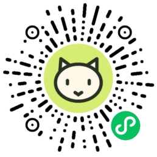

# 怪相馆 · WechatMemeLab

开源动态表情包工具：上传照片或截取一段视频，捏、拉、揉出聊天里的怪相，导出循环 GIF。仓库同时包含网页版和原生微信小程序。

## 体验入口

- **网页版**：[怪相馆 · GitHub Pages](https://swording-k.github.io/WechatMemeLab/)。照片整活、自由捏图、文字与猫狗贴图、视频转 GIF，以及 **AI 表情创作（内测，需登录）**；照片和视频编辑都在浏览器本地处理。
- **微信小程序**：微信搜索 **「怪相馆」**，或用微信扫一扫：



小程序 **0.5.2 工具与账户候选版**已上传开发版本，尚未重新提审或正式发布。个人主体的 AI 服务审核未通过，因此小程序内保留照片、视频工具、微信账户与充值，AI 创作在网页版提供；网页和小程序共用账户点数。此前真实苹果充值和 AI 扣点已有验证，本轮恢复入口未再次扣款，不保证此次审核通过。

## 版本与代码结构

当前候选分支包含小程序 **0.5.2** 源码；网页版与小程序在同一仓库的不同目录。iOS 在独立工作树开发，尚未验收完成。

- **网页版（公开站）**：`index.html`、`video.html`、`feedback.html`、`motion.html`、`account.html` 与 `src/`。AI 创作与账户页已随公开站构建，但 AI 需要微信账户登录或朋友内测邀请码，见下文。
- **微信小程序（0.5.2）**：`miniprogram/` 原生实现，含照片编辑、视频剪辑、微信账户、充值、网页版介绍和微信内容安全检测；AI 页面不进入上传包。`miniprogram/core/engine.js` 由 `npm run build:miniprogram` 从共享效果引擎生成，随源码提交，方便开发者工具直接导入。
- **云端函数**：`cloudfunctions/meme-feedback`（站内反馈、微信内容安全）和 `cloudfunctions/meme-motion`（AI 创作任务、账户与订单）。`server/motion/` 是本地回环后端，不部署到公开站。
- **文档**：`docs/` 保存验证记录和设计说明；项目约定见 `AGENTS.md`。

### 网页版功能

照片工作台有 **14 种预设＋自由捏图**：变猫、变狗、捏、拉、揉、吸走理智、融化、漏气，以及被消息震飞、脸先破防和挤进屏幕等。自由捏图支持局部拉拽、鼓起、缩小、多步叠加、撤销清空。文字和猫狗贴图可在画布上直接点选、拖动、旋转、缩放，支持撤销/重做；预设可复制不含照片的玩法链接。

页面顶部可切换 **照片整活／视频表情／AI 表情创作／我的账户**。视频工作台支持最长 6 秒片段、原片／来回／倒放三种起点、文字位置、速度、原比例或方形取景及 GIF 导出；视频只在本机解码，浏览器无法解码的素材需换成兼容 MP4，GIF 不含声音。

**AI 表情创作（内测）**在网页上提供一句话生图、上传照片改图、写动作或学参考视频；生成后可在网页剪辑取景、配字并导出 GIF/图片。需要微信账户登录（在小程序「我的 → 网页端登录」确认）或朋友内测邀请码；未登录时只显示登录与邀请码面板。

### 微信小程序功能

小程序工具版提供：照片取景与框选、15 个预设卡片（含本地循环 GIF 示例）、自由捏图、文字四种样式/颜色/位置、猫狗贴图双指缩放旋转、背景与作用范围、笔刷、撤销重做、240/320/480px GIF 导出；原生视频工作台（选段、循环、任意矩形取景、字幕、播放方向）；微信账户、创作点充值、网页登录确认和历史订单查询；AI 创作功能在网页版提供。选择照片、导出帧和公开反馈接入微信内容安全检测，检测不通过不放行。

## AI 表情创作（网页版，按点数计费）

AI 链路为「一句话生图 → 自然语言改图 → 生成约 2 秒动作 → 剪辑取景配字 → 导出 GIF/图片」。动作可以写一段话描述，也可以提供 2～6 秒参考视频让角色模仿。每一步由用户单独确认，不静默连调；未知提交不重建、不重复提交，避免重复扣费。

- 模型为阿里云百炼通义万相，API Key 只保存在云端函数或忽略的本地配置，客户端不含密钥。
- 当前已启用AI按点数计费：1元=100点；生图/改图50点，2秒动作80点，参考动作80点/秒（向上取整）。真实苹果充值入账、AI扣点及重复提交幂等已验证；现金退款暂只有自动测试，尚未做实际Apple退款。照片整活、视频转GIF仍免费。
- 网页版与小程序共用同一 CloudBase 后端：网页入口为 `motion.html`，需微信账户登录（在小程序「我的 → 网页端登录」输入网页登录码）或朋友邀请码；账户页为 `account.html`，登录与任务记录按微信账户同步。源码位于 `src/motion/`、`src/account/` 和 `cloudfunctions/meme-motion/`。
- AI 生成素材和描述会经腾讯云后端交给阿里云处理；每次生成前界面会说明处理方。

## 本地运行和验证

需要 Node.js 22.12+、已安装的 Chrome；3 项 MP4 解析测试还需要 `ffmpeg`（GitHub Actions 会安装）。网页 AI 的生产构建默认连接现有 CloudBase 函数，本地开发使用 `server/motion` 回环后端；可用 `VITE_MOTION_CLOUD_ENDPOINT` 覆盖为其他 HTTPS 地址。

```sh
npm ci
npm ci --prefix cloudfunctions/meme-motion
npm run dev
```

另一个终端运行：

```sh
npm test
npm run build
```

`npm test` 当前为 209 项 Node 测试，覆盖照片与视频编辑、GIF 编码、反馈后端、小程序共享引擎、AI 任务与账户逻辑。`npm run build` 执行 `tsc --noEmit` 和公开站（含 AI/账户页）构建。

浏览器流程测试（需要 Chrome，按需运行）：

```sh
npm run test:browser
npm run test:editor
npm run test:layers
npm run test:caption
npm run test:effects
npm run test:chat-effects
npm run test:sculpt
npm run test:video
node tests/feedback-browser.mjs
node tests/pet-effects-browser.mjs
```

`npm run preview` 检查生产构建，`TEST_URL=http://127.0.0.1:4173/ npm run test:browser` 可在生产预览上运行相同流程。临时文件位于忽略的 `work/qa/`。

可选独立 GIF 解码（Python + Pillow）：

```sh
python3 scripts/verify-gifs.py work/qa/*-release.gif work/qa/portrait-*.gif
```

## 小程序开发

```sh
npm ci
npm run build:miniprogram
```

用微信开发者工具导入 `miniprogram/`（不要导入网页根目录）。AppID 为 `wxe487c77e0ea5329a`。修改共享效果后必须重新运行 `npm run build:miniprogram`，不要手工编辑 `core/engine.js`，也不要提交含本机绝对路径的构建产物。

小程序 request 合法域名需要允许现有 CloudBase 反馈域名与 AI 函数域名；上传/下载还需允许 COS 存储域名。详细说明见 [小程序 README](miniprogram/README.md) 和 [AI 后端说明](cloudfunctions/meme-motion/README.md)。

## 隐私与数据处理

- 网页版的照片和视频编辑在浏览器本地完成，照片不上传服务器；只有用户主动提交反馈或使用 AI 时，素材才按页面说明上传。
- 小程序为内容安全检测，会把所选照片、AI 生成图片、用户文字和输出 GIF 的检测副本发送到本站腾讯云后端及微信内容安全接口，检测后删除。
- 使用 AI 功能时，所选照片、动作描述和参考视频会上传到腾讯云后端并交由阿里云处理。网页 AI 目前只依赖供应商内容过滤，不等同微信内容安全检测；小程序 AI 另做微信检测。
- 具体范围见 [小程序隐私补充说明](docs/小程序隐私补充说明.txt)。

## 实际边界

自动人脸检测针对清晰人脸，侧脸、遮挡、远处小脸、宠物和插画可能识别不出，允许人工修正。不自动抠图、不重建人物表情，也不提供双人分别上传合成。GIF 最多 256 色，照片有色彩损失；透明 PNG 会合成到所选背景，不输出透明 GIF。

小程序已提交微信审核，结果尚未公布：真机上的选图、双指、键盘、GIF 相册保存以及微信/抖音发送仍需验收，不宣称直接拖拽、自动加入收藏或收藏同步。支付与真实交易未验收。网页 AI 依赖微信账户登录，小程序正式发布前普通访客无法完成登录，实际可体验人群有限。AI 目前只有少量真实样本，不保证任意提示词都能得到满意结果；技术验证和发布不证明用户喜欢或会广泛传播。

详情：[开发计划](docs/开发计划.md)、[效果标准](docs/效果设计标准.md)、[验证记录](docs/验证记录.md)、[账户与支付验收](docs/2026-10-28-账户支付验收.md)、[项目约定](AGENTS.md)。

## GitHub Pages 发布

`.github/workflows/pages.yml` 在 `main` 推送后自动安装依赖（含 AI 云函数依赖）、运行 209 项测试、构建并部署 `dist`。公开构建包含照片、视频、反馈、AI 创作和账户页；AI/账户入口需要登录或邀请码，不代表对所有人开放。AI 页的跨域请求与素材上传已允许 GitHub Pages 来源（免费 CloudBase 套餐无法在控制台新增安全域名，函数改为自行响应 CORS 预检，COS 存储也已放行该来源）。静态资源及本地识别人脸的 Worker 支持项目子路径。2026-10-29 合入小程序 0.4.5 主代码后已实际部署成功（run 40850427812）；当晚加回 AI/账户页后再次部署成功（run 40855066020），线上导航为 4 个入口。

## 源码、作者和反馈

两个工作台的页脚提供 GitHub 源码、问题与建议、作者主页入口；页头也可直接进入反馈渠道。

- 源码：https://github.com/swording-k/WechatMemeLab
- 站内反馈：`feedback.html`。无需 GitHub 账号，支持最多三张截图或 GIF 的选择、预览、移除、拖入和粘贴。静态截图自动缩小，每张 GIF 最大 1 MB，附件合计最大 2 MB。
- 提交后由腾讯云持久保存，GitHub Actions 每 15 分钟尝试同步为公开 Issue，并回写链接。调度可能延迟；页面可查询进度。邮件与 GitHub 入口保留作备用，附件需在对应应用中另行添加。
- 编辑照片和视频仍在设备本地处理，反馈附件按提交说明上传；网页 AI 会把素材交给腾讯云和阿里云处理，小程序的内容安全检测和 AI 创作另有网络处理。
- Issue 模板默认指派作者。邮件通知取决于 GitHub 账户的通知设置；当前未验证实际收信。
- 作者个人主页：https://swording-k.github.io/#contact

猫狗预设使用原创动物耳朵、胡须、鼻子和舌头，动作与局部脸部变形同步；检测到清晰人脸时，鼻子位置和头部倾斜取自本地关键点。已移除「灵魂出窍」「贴到玻璃上」。验证：`node tests/pet-effects-browser.mjs`。

## 画布直接编辑

点选文字或猫狗贴图后直接拖动。选框上方旋转、右下角缩放；手机可双指移动、缩放和旋转。支持撤销、重做和摆正，位置滑杆默认收在“精细调整”中。双击文字可编辑内容，方向键可微调选中对象。编辑时定格，点击“预览成品”播放且隐藏编辑辅助控件。GIF 导出与预览使用同一变换。验证见 [画布直接编辑验证](docs/2026-10-10-画布直接编辑验证.md)。

## 反馈后端部署

过渡期经用户授权共用 FitGenius 免费 CloudBase 环境，独立函数 `meme-feedback-api`、集合 `meme_feedback` / `meme_feedback_limits`、存储前缀 `meme-feedback/`。后续迁往自有服务器；不升级套餐。

函数源代码位于 `cloudfunctions/meme-feedback`，入口 `index.main`，Event 函数 Nodejs20.19、256 MB、20 秒。以 `cloudbaserc.example.json` 准备不纳入版本控制的部署配置，并设置 `FEEDBACK_PUBLIC_URL`、`FEEDBACK_ORIGINS`、随机 `FEEDBACK_SYNC_SECRET`。真实配置不入库。部署时指定函数目录并创建 HTTP 路由 `/meme-feedback-api`，使用控制台提供的实际区域网关地址。

GitHub Repository Variable `FEEDBACK_API_URL` 与 Secret `FEEDBACK_SYNC_SECRET` 配好后，由 `.github/workflows/feedback-sync.yml` 定时或手动同步。CI 使用内置 GITHUB_TOKEN，腾讯云不保存 GitHub 个人令牌。附件用固定代理地址引用，服务获取短期存储链接再跳转。

上传请求以二进制内容类型传送 JSON，适配 CloudBase 文本请求 100 KB 限制；服务仍验证 JSON、图片魔数、尺寸和来源，最大读取 3 MB。配置迁移时更新前端 `VITE_FEEDBACK_API`、云函数公开地址及 GitHub Variable。公开反馈附件随 Issue 可访问，请先遮挡私人信息。